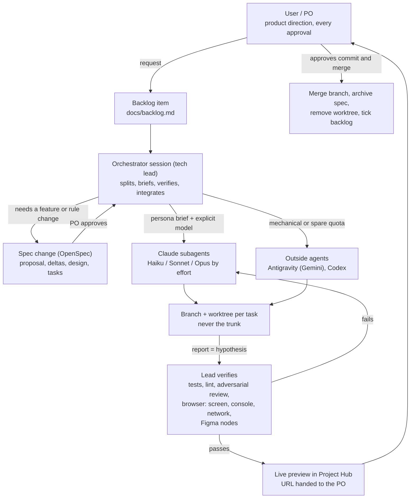

# AI Development Architecture

How I build software with AI agents: one orchestrator session acting as tech lead, subagents
acting as developers on the cheapest model that can do the job, outside agents to spread quota,
a branch and a worktree per task, specs written and approved before code, and verification in a
real browser before anything is merged.

This repo documents the method and ships the reusable pieces: my own Claude Code skills and a
generic `CLAUDE.md` plus a subagent brief template. It is a description of a working setup, not a
framework. Everything here is something I actually use day to day.

## Why

Agentic coding fails in predictable ways: a long session drowns in its own context, a "done" report
turns out to be wrong, parallel agents trample each other's files, a spec gap gets filled with a
guess, and the quota runs out halfway through a task. Each practice below answers one of those.

| Problem | Practice |
|---|---|
| Context grows, every turn gets more expensive | Orchestrator keeps a small context; typing is delegated |
| One expensive model for everything | Model chosen per task by effort (cheap / mid / top tier) |
| Agents collide or touch the trunk | Branch + worktree per task, agents never touch the trunk |
| "Done" reports that are not true | A report is a hypothesis; the lead verifies files, exit codes and the running app |
| Agents guess when the spec is silent | Spec-driven development; on a gap the agent stops and asks |
| The human cannot judge a diff in a hidden worktree | Live preview in a dashboard before merge |
| Quota runs out mid-task | Measure first, spread across providers, refuse what does not fit |

## The flow

Reading it left to right: the PO asks, the request becomes a backlog item, the orchestrator decides
whether it needs a spec, delegates closed tasks to cheap workers in isolated worktrees, verifies
the results itself, shows them running, and only merges after the PO says yes.

## Principles

1. **The PO decides, the lead orchestrates, agents execute.** Product, risk and every approval
   (commit, merge, push, deploy, deletion) belong to the human. Approvals are per action and never inherited.
2. **Delegate by default, on the cheapest capable worker.** The orchestrator's context is the scarce resource.
3. **One task, one branch, one worktree.** Agents never touch the trunk and never push.
4. **A report is not proof.** The lead checks files, exit codes and the running app.
5. **Not found means ask, never invent.** Spec, contract, design or code silent on a point: stop and report the gap.
6. **Spec first for features and rule changes.** Written, reviewed and approved before any agent codes.
7. **Browser first, Figma first.** Reproduce at the start, verify at the end, read design nodes instead of eyeballing screenshots.
8. **Measure the budget.** Context and quota are read from snapshots, not guessed; a task that does not fit does not start.
9. **Show it running before merge.** The PO approves what they have seen.
10. **Be brief.** Agent-to-agent text is English, direct, no prose; replies to the human are 1-3 lines of status.

## Documentation

| Doc | Topic |
|---|---|
| [orchestration-and-subagents](docs/orchestration-and-subagents.md) | Roles, what to delegate, the brief, outside agents, recruits |
| [spec-driven-development](docs/spec-driven-development.md) | OpenSpec lifecycle with an anonymized example |
| [workflow-branch-worktree](docs/workflow-branch-worktree.md) | The per-task loop, worktree rules, preview before merge |
| [verification](docs/verification.md) | Definition of done, adversarial review, browser-first and Figma-first |
| [budget-and-models](docs/budget-and-models.md) | Context and quota discipline, model by effort |
| [backlog-convention](docs/backlog-convention.md) | One backlog file per project |
| [tooling](docs/tooling.md) | Claude Code, OpenSpec, Antigravity, Codex, Maestri, rtk, Project Hub |

## Reusable pieces

- [skills/](skills/README.md): my own Claude Code skills (`agent-dev-workflow`, `hub-previews`, `token-saving`, `keep-awake`).
- [templates/CLAUDE.md](templates/CLAUDE.md): a generic global instruction file.
- [templates/subagent-brief.md](templates/subagent-brief.md): the brief every subagent gets.

## Status and honesty

This is a personal workflow, tuned for one developer working with several agents on one machine
(Linux, Docker, Claude Code in an editor). Thresholds (150k context, 5-point quota reserve, 5 open
worktrees, 2 concurrent recruits) are values I settled on from experience, not universal constants.
Some helper scripts the skills mention are personal and not published; the docs say what they do.

## License

MIT, see [LICENSE](LICENSE).
